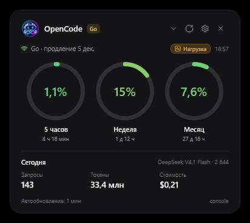
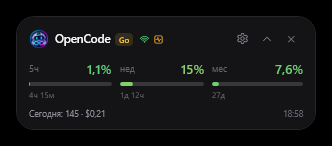
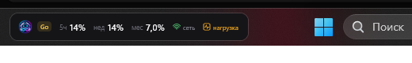
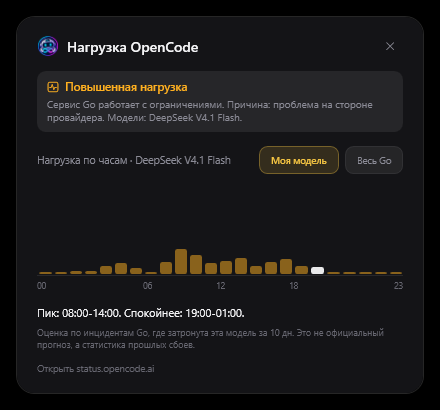
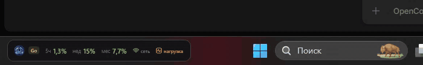

# OpenCode Go Widget


[Русский](README.md) | **English**

A compact Windows widget that shows the remaining **OpenCode Go** subscription limits:
the 5-hour window, the week and the month, plus today's usage statistics.
Three modes: normal, compact and a bar in the Windows 11 taskbar.

Normal view:



Compact view:



Taskbar mode:



## Download

Ready-to-run build: [latest release](https://github.com/anteaterantibus-tech/OpenCode_LimitWidget/releases/latest).

- `OpenCodeWidget.exe` (about 2 MB) requires the .NET 9 Desktop Runtime.
- `OpenCodeWidget-self-contained.exe` (about 147 MB) runs without .NET installed,
  but the first launch is slightly slower because it unpacks the runtime.

## Why this widget

- Native Windows/WPF, one exe, no Electron and no browser sign-in.
- Three modes, including a bar in the Windows 11 taskbar.
- Focused on OpenCode Go: 5 hours, week, month, reset timers and today's stats.
- Official OpenCode status and an hourly load forecast.
- Indicator colors shift from green to red as the limit is consumed.
- Russian and English UI, switchable in settings without a restart.
- Sound notifications, fullscreen auto-hide, key protected by DPAPI.
- No telemetry.

## Similar projects

- [CodeZeno/Claude-Code-Usage-Monitor](https://github.com/CodeZeno/Claude-Code-Usage-Monitor) - Windows taskbar widget for Claude Code, Codex, Cursor and OpenCode Go.
- [slkiser/opencode-quota](https://github.com/slkiser/opencode-quota) - OpenCode quotas, usage and cost inside the TUI and Desktop.
- [Javis603/token-monitor](https://github.com/Javis603/token-monitor) - cross-platform dashboard for 52+ tools.
- [ikunops/opencode-widget](https://github.com/ikunops/opencode-widget) - floating window with OpenCode Go quotas and per-model breakdown.
- [bozdemir/claude-usage-widget](https://github.com/bozdemir/claude-usage-widget) - cross-platform OSD with forecasts and burn alerts for Claude and Codex.

## What it shows

- Three rings with the used quota percentage: 5 hours, week, month.
- The ring and percentage color depends on usage: 0% green, 50% yellow, 75% orange, 90% red.
  This is the same for all three windows: the less limit is left, the redder the indicator.
- Time until each window resets.
- Plan and renewal date.
- Today's statistics: requests, tokens, cost and the most used model.
- A data freshness indicator and an error banner when the key or network is unavailable.
- Compact mode: the same limits as three short bars, without extra details.
- Taskbar mode: a thin limit bar in the free part of the Windows taskbar.
- Auto-hide when a game or movie is fullscreen.
- Notifications at 70%, 90% and 100% of a limit: a card below the widget, sound and frame glow.
- OpenCode load indicator: shows when the Go service is degraded due to latency or provider issues.
- Forecast window: click the indicator to see which hours are more likely to have load.

## How it works

The widget talks to the same OpenCode console endpoints that the web UI uses:

- `GET https://opencode.ai/console/api/go/status` - limits and subscription state;
- `GET https://opencode.ai/console/api/activity/go` - daily statistics and models;
- `GET https://status.opencode.ai/api/status` - public status of OpenCode services and models.

Authentication uses a personal OpenCode API key (`oc_sk_...`).
The key is sent only to `opencode.ai`; there is no telemetry and no third-party traffic.
The status page is requested without a key and only reads public data.

If the network is unavailable, the widget retries after 10 seconds to recover quickly
after sleep or reconnection. On HTTP 429 the delay grows to one minute.
The widget does not use Google sign-in: an API key is enough.

## Requirements

- Windows 10 or Windows 11, x64.
- .NET 9 Desktop Runtime to build from source or to run the framework-dependent build.
- For a portable build on another computer, use the self-contained command below.

## Install and run

```powershell
git clone https://github.com/anteaterantibus-tech/OpenCode_LimitWidget.git
cd OpenCodeWidget
dotnet run
```

Or build a single-file exe:

```powershell
.\build.ps1
```

The result is `dist\OpenCodeWidget.exe`.
On a machine without .NET 9 use the self-contained command below.
You can also download the ready exe from the [latest release](https://github.com/anteaterantibus-tech/OpenCode_LimitWidget/releases/latest).

## First launch and API key

On first launch the widget tries to import the OpenCode Go key from the local OpenCode database:

```text
opencode db "select value from credential where integration_id='opencode-go' order by time_updated desc limit 1" --format json
```

If a key is found, it is stored encrypted and the widget starts working immediately.
If not, the settings window opens: paste the key manually.

Create a key here:

```text
OpenCode Console -> Account -> Personal API keys
```

**Usage: Read** access is enough (or **All**). A key created for the Go subscription also works.

The key is stored in `%APPDATA%\OpenCodeWidget\settings.json` and encrypted by Windows
(DPAPI, bound to the current user account). It is never written to disk in plain text.

The repository contains no key. Do not commit `settings.json`, logs or your API keys.

## Controls

- Drag the widget by the top part of the card.
- Refresh, settings and hide-to-tray buttons.
- Switch normal and compact views: the chevron in the header, the tray menu or `Ctrl+M`.
- Taskbar mode: right-click the widget or use the tray menu.
- `Ctrl+R` refreshes, `Esc` hides to tray.
- Right-click the card for the context menu.
- Double-click the tray icon to show the widget.
- Tray menu: show, refresh, settings, compact mode, autostart, exit.
- The selected view is saved between launches.

## Notifications

At 70%, 90% and 100% of a limit the widget shows a compact card below itself,
plays the selected sound and enables a steady frame glow. The card matches the widget width
but stays short so it does not look like a second widget.

Sounds: Soft, Bell, Wood, Drop, Tone. In settings you can preview each one
and press Test notification to see the full card.
Notifications are not shown in fullscreen games and movies.

## OpenCode load

The widget reads the public `status.opencode.ai` page on every refresh cycle
and looks at the `go` service.


- When everything is fine, the indicator is green.
- On degradation an amber Load chip appears next to the renewal date.
- On an outage the chip turns red and shows Outage.
- In compact mode an activity icon appears next to the logo.
- In the taskbar there are two labeled icons: net (connection) and load (OpenCode state).

The Wi-Fi icon shows connectivity: green means data is refreshing, red means no connection.
The activity icon shows load: green is normal, amber is degraded, red is an outage.

Hover the chip to see the reason (latency, errors, provider-side issue) and the affected models.
Click it to open the load forecast window.

The forecast window has a 24-hour chart: how long the Go service was degraded
in each hour over the last days. Below the chart there is a summary such as
`Peak: 09:00-15:00. Quieter: 21:00-03:00.` The current hour is highlighted in white.

By default the forecast is built for the model that was used most today:
the widget takes it from the daily activity statistics. This is not necessarily
the model selected right now, but the most used one today, which is usually the current one.
The My model / All Go switch changes the chart: one model or all Go incidents.



This is not global server load but the official status: if OpenCode reports
a Go or model degradation, requests may be slow or fail.
At such moments it makes sense to pause so you do not spend limits on retries.

The forecast window is a statistic of past incidents over the last days, not an official schedule.
It shows which hours had more load and helps choose a time to work.

## Taskbar mode

The widget can be pinned to the free part of the Windows taskbar.
Switch it from the widget's right-click menu or the tray menu.
Double-click the bar to return to the normal view.



On Windows 11 the bar sits in the free left area; on Windows 10 it is placed near the tray,
to the left of the notification area, because Windows 10 keeps app icons on the left.

This is a separate topmost window above the taskbar, not a system deskband:
Windows 11 does not support third-party deskbands. The mode is designed for a bottom taskbar
with centered icons. If icons are left-aligned, the taskbar is vertical, or auto-hide is enabled,
the bar may overlap taskbar elements or stay at the edge. In those cases use the normal or compact view.

## Settings

- OpenCode Go API key.
- Refresh interval: 30 seconds, 1 minute, 5 minutes, 15 minutes.
- Always on top.
- Start with Windows.
- Hide in fullscreen apps (enabled by default).
  The widget hides when a game or movie is fullscreen and comes back afterwards.
- Limit notifications.
- Sound and its variant: Soft, Bell, Wood, Drop, Tone. Preview and Test notification buttons.
- Frame glow at 70%, 90% and 100%.
- UI language: Russian or English. Applied immediately, without a restart.

Autostart is written to `HKCU\Software\Microsoft\Windows\CurrentVersion\Run`.
If you move the exe, enable autostart again so the path is updated.

## Build and publish

Regular build:

```powershell
dotnet build -c Release
```

Framework-dependent single-file (requires the .NET 9 Desktop Runtime):

```powershell
dotnet publish -c Release -r win-x64 --self-contained false -p:PublishSingleFile=true -p:IncludeNativeLibrariesForSelfExtract=true -o dist
```

Self-contained single-file (runs without .NET, larger):

```powershell
dotnet publish -c Release -r win-x64 --self-contained true -p:PublishSingleFile=true -p:IncludeNativeLibrariesForSelfExtract=true -o dist
```

GitHub Actions builds the framework-dependent exe on every push and uploads it as an artifact.
Workflow: `.github/workflows/build.yml`.

## Project structure

```text
OpenCodeWidget.csproj      WPF project
App.xaml, App.xaml.cs      startup, tray, key import
MainWindow.xaml            widget card
LoadWindow.xaml            load forecast window
LimitToastWindow.xaml      notification card
SettingsWindow.xaml        settings window
Controls/                  ring and compact indicators
Models/GoModels.cs         API response models
Models/StatusModels.cs     status page response models
Resources/Strings.*.xaml   Russian and English UI strings
Services/GoApiClient.cs    console HTTP client
Services/StatusApiClient.cs OpenCode status client
Services/LoadForecast.cs   hourly load profile
Services/Loc.cs            localization runtime
Services/HttpClientFactory.cs shared HTTP client with IPv4 preference
Services/SettingsStore.cs  settings and DPAPI encryption
Services/TrayIconManager.cs tray icon and menu
Services/OpenCodeKeyImporter.cs key import from OpenCode
Services/StartupManager.cs autostart
Services/TaskbarLocator.cs taskbar position
Services/WidgetMode.cs     widget modes
assets/logo.png            widget logo
assets/sounds/*.wav        notification sounds
app.ico                    application icon
```

## Limitations

- The console endpoints are not a public documented API and may change.
- The status page shows the official service state, not exact server load.
- The API returns a normalized plan quota; the ring percentages match what the console shows.
- Windows only.
- If the key is revoked or has no access to usage data, the widget shows an error and offers settings.

## License

MIT. See [LICENSE](LICENSE).

## Disclaimer

Unofficial project. Not affiliated with OpenCode or Anomaly.
It uses internal OpenCode console endpoints that may change without notice.
