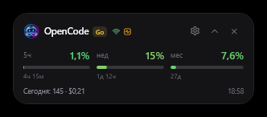
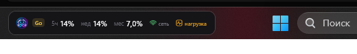
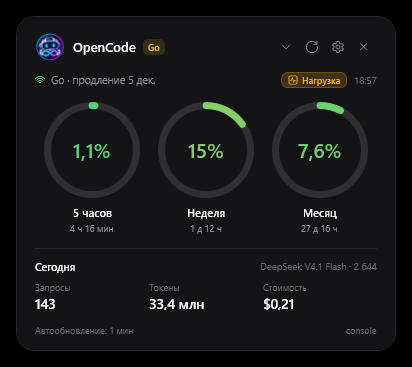
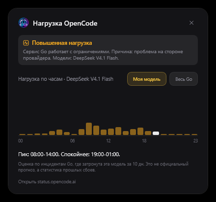
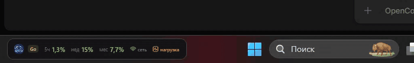

# OpenCode Go Widget


Компактный виджет для Windows, который показывает остаток лимитов подписки **OpenCode Go**:
5-часовое окно, неделю и месяц, а также статистику использования за сегодня.
Три режима: обычный, компактный и полоса в панели задач Windows 11.

Обычный вид:


Компактный вид:



Режим панели задач:



## Скачать

Готовый файл: [последний релиз](https://github.com/anteaterantibus-tech/OpenCode_LimitWidget/releases/latest).
`OpenCodeWidget.exe` требует установленный .NET 9 Desktop Runtime. Если .NET нет,
соберите self-contained версию командой из раздела ниже.

## Чем отличается

- Нативный Windows/WPF, один exe, без Electron и без входа через браузер.
- Три режима, включая полосу в панели задач Windows 11.
- Фокус на OpenCode Go: 5 часов, неделя, месяц, сбросы и статистика за сегодня.
- Официальный статус OpenCode и прогноз нагрузки по часам.
- Цвет индикаторов от зелёного к красному по остатку лимита.
- Уведомления со звуком, автоскрытие в полноэкранных приложениях, ключ в DPAPI.
- Никакой телеметрии.

## Похожие проекты

- [CodeZeno/Claude-Code-Usage-Monitor](https://github.com/CodeZeno/Claude-Code-Usage-Monitor) - виджет в панели задач Windows для Claude Code, Codex, Cursor и OpenCode Go.
- [slkiser/opencode-quota](https://github.com/slkiser/opencode-quota) - квоты, расход и стоимость OpenCode прямо в TUI и Desktop.
- [Javis603/token-monitor](https://github.com/Javis603/token-monitor) - кроссплатформенный дашборд по 52+ инструментам.
- [ikunops/opencode-widget](https://github.com/ikunops/opencode-widget) - плавающее окно с квотами OpenCode Go и разбивкой по моделям.
- [bozdemir/claude-usage-widget](https://github.com/bozdemir/claude-usage-widget) - кроссплатформенный OSD с прогнозами и burn-алертами для Claude и Codex.

## Что показывает

- Три кольца с процентами использованной квоты: 5 часов, неделя, месяц.
- Цвет кольца и процента зависит от расхода: 0% зелёный, 50% жёлтый, 75% оранжевый, 90% красный.
  Это одинаково для всех трёх окон: чем меньше лимита осталось, тем краснее индикатор.
- Время до сброса каждого окна.
- Тариф и дату продления подписки.
- Статистику за сегодня: запросы, токены, стоимость и самую используемую модель.
- Индикатор свежести данных и баннер ошибки, если ключ или сеть недоступны.
- Компактный режим: те же лимиты в виде трех коротких полос, без лишних деталей.
- Режим панели задач: тонкая полоса с лимитами в свободной части панели задач Windows 11.
- Автоскрытие, когда игра или фильм развернуты на весь экран.
- Уведомления при 70%, 90% и 100% лимита: карточка под виджетом, звук и подсветка рамки.
- Индикатор нагрузки OpenCode: видно, когда сервис Go деградирует из-за задержек или проблем провайдера.
- Окно прогноза: по клику на индикатор показывает, в какие часы нагрузка появляется чаще.

## Как это работает

Виджет обращается к тем же endpoint'ам консоли OpenCode, которые использует веб-интерфейс:

- `GET https://opencode.ai/console/api/go/status` - лимиты и состояние подписки;
- `GET https://opencode.ai/console/api/activity/go` - дневная статистика и модели;
- `GET https://status.opencode.ai/api/status` - публичное состояние сервисов и моделей OpenCode.

Авторизация выполняется персональным API-ключом OpenCode (`oc_sk_...`).
Ключ отправляется только на `opencode.ai`, никакой телеметрии и сторонних запросов нет.
Запрос к странице статуса выполняется без ключа и только читает публичные данные.

Если сеть недоступна, виджет повторяет запрос через 10 секунд, чтобы быстро восстановиться
после сна компьютера или переподключения. При ответе 429 пауза увеличивается до минуты.
Вход через Google в виджете не используется: достаточно API-ключа.

## Требования

- Windows 10 или Windows 11, x64.
- .NET 9 Desktop Runtime для сборки из исходников или framework-dependent версии.
- Для переносимой версии на другой компьютер соберите self-contained вариант (команда ниже).

## Установка и запуск

```powershell
git clone https://github.com/anteaterantibus-tech/OpenCode_LimitWidget.git
cd OpenCodeWidget
dotnet run
```

Или соберите single-file exe:

```powershell
.\build.ps1
```

Готовый файл появится в `dist\OpenCodeWidget.exe`.
На компьютере без установленного .NET 9 используйте self-contained команду из раздела ниже.
Готовый exe также можно скачать из [последнего релиза](https://github.com/anteaterantibus-tech/OpenCode_LimitWidget/releases/latest).

## Первый запуск и ключ

При первом запуске виджет пытается автоматически забрать ключ OpenCode Go из локальной базы OpenCode:

```text
opencode db "select value from credential where integration_id='opencode-go' order by time_updated desc limit 1" --format json
```

Если ключ найден, он сохраняется в зашифрованном виде и виджет сразу начинает работать.
Если ключа нет, откроется окно настроек: вставьте ключ вручную.

Ключ можно создать здесь:

```text
OpenCode Console -> Account -> Personal API keys
```

Ключу достаточно доступа **Usage: Read** (или **All**). Готовый ключ из подписки Go тоже подходит.

Ключ хранится в `%APPDATA%\OpenCodeWidget\settings.json` и шифруется средствами Windows
(DPAPI, привязка к текущей учетной записи). В открытом виде на диск он не попадает.

В репозитории ключа нет. Не коммитьте `settings.json`, логи и свои API-ключи.

## Управление

- Перетаскивание за верхнюю часть карточки.
- Кнопка обновления, настройки и скрытия в трей.
- Переключение обычного и компактного вида: шеврон в шапке, пункт в трее или `Ctrl+M`.
- Режим панели задач: правый клик по виджету или меню в трее.
- `Ctrl+R` - обновить, `Esc` - скрыть в трей.
- Правый клик по карточке - контекстное меню.
- Двойной клик по иконке в трее - показать виджет.
- Меню в трее: показать, обновить, настройки, компактный режим, автозапуск, выход.
- Выбранный вид сохраняется между запусками.

## Уведомления

При достижении 70%, 90% и 100% лимита виджет показывает компактную карточку под собой,
проигрывает выбранный звук и включает ровную подсветку рамки. Карточка совпадает по ширине
с виджетом, но остается низкой, чтобы не выглядеть как второй виджет.

Звуки: Мягкий, Звон, Дерево, Капля, Тон. В настройках можно прослушать каждый вариант
и нажать «Тест уведомления», чтобы увидеть карточку целиком.
В полноэкранных играх и фильмах уведомления не показываются.

## Нагрузка OpenCode

Виджет раз в цикл обновления читает публичную страницу статуса `status.opencode.ai`
и смотрит состояние сервиса `go`.



- Если все в норме, индикатор скрыт.
- При деградации рядом с датой продления появляется янтарная плашка «Нагрузка».
- При сбое плашка становится красной и показывает «Сбой».
- В компактном режиме рядом с логотипом горит значок активности.
- В панели задач рядом с лимитами два значка с подписями: «сеть» (подключение) и «нагрузка» (состояние OpenCode).

Значок Wi-Fi показывает связь: зелёный - данные обновляются, красный - нет связи.
Значок активности показывает нагрузку: серый - норма, янтарный - деградация, красный - сбой.

Наведите на плашку, чтобы увидеть причину (`задержки`, `ошибки`, `проблема на стороне провайдера`)
и затронутые модели. Клик открывает окно с прогнозом нагрузки.

В окне прогноза есть график по 24 часам: сколько времени сервис Go был деградирован
в каждый час за последние дни. Под графиком выводится сводка вида
`Пик: 09:00-15:00. Спокойнее: 21:00-03:00.` Белым столбиком отмечен текущий час.

Прогноз по умолчанию строится по модели, которая чаще всего использовалась сегодня:
виджет берёт её из дневной статистики активности. Это не «модель, выбранная прямо сейчас»,
а самая используемая за день, обычно она и есть текущая. Переключатель
«Моя модель / Весь Go» меняет график: одна модель или все инциденты Go.



Это не глобальная «загруженность сервера», а официальный статус: если OpenCode сообщает
о деградации Go или конкретной модели, запросы могут идти медленно или падать.
В такой момент имеет смысл сделать паузу, чтобы не тратить лимиты на повторные попытки.

Прогноз в окне это статистика прошлых сбоев за последние дни, а не официальное расписание.
Он показывает, в какие часы нагрузка появлялась чаще, и помогает выбрать время для работы.

## Режим панели задач

Виджет можно закрепить в свободной левой части панели задач Windows 11.
Переключение: правый клик по виджету и пункт «В панели задач» или то же самое в меню трея.
Двойной клик по полосе возвращает обычный вид.



Это отдельное topmost-окно поверх панели задач, а не системный deskband:
Windows 11 не поддерживает сторонние deskband. Режим рассчитан на панель задач снизу
с выровненными по центру значками. Если значки выровнены влево, панель вертикальная
или включено автоскрытие, полоса может перекрывать элементы панели или оставаться на краю.
В таких случаях используйте обычный или компактный вид.

## Настройки

- API-ключ OpenCode Go.
- Интервал обновления: 30 секунд, 1 минута, 5 минут, 15 минут.
- Поверх всех окон.
- Запуск вместе с Windows.
- Скрывать в полноэкранных приложениях (по умолчанию включено).
  Виджет прячется, когда игра или фильм развернуты на весь экран, и возвращается после.
- Уведомления о лимитах.
- Звук и его вариант: Мягкий, Звон, Дерево, Капля, Тон. Кнопки «Прослушать» и «Тест уведомления».
- Подсветка рамки при 70%, 90% и 100%.

Автозапуск прописывается в `HKCU\Software\Microsoft\Windows\CurrentVersion\Run`.
Если перенести exe в другое место, включите автозапуск заново, чтобы обновить путь.

## Сборка и публикация

Обычная сборка:

```powershell
dotnet build -c Release
```

Framework-dependent single-file (нужен установленный .NET 9 Desktop Runtime):

```powershell
dotnet publish -c Release -r win-x64 --self-contained false -p:PublishSingleFile=true -p:IncludeNativeLibrariesForSelfExtract=true -o dist
```

Self-contained single-file (работает без установленного .NET, размер больше):

```powershell
dotnet publish -c Release -r win-x64 --self-contained true -p:PublishSingleFile=true -p:IncludeNativeLibrariesForSelfExtract=true -o dist
```

GitHub Actions собирает framework-dependent exe при каждом push и складывает его в артефакты.
Файл workflow: `.github/workflows/build.yml`.

## Структура проекта

```text
OpenCodeWidget.csproj      проект WPF
App.xaml, App.xaml.cs      запуск, трей, импорт ключа
MainWindow.xaml            карточка виджета
LoadWindow.xaml            окно прогноза нагрузки
LimitToastWindow.xaml      карточка уведомления
SettingsWindow.xaml        окно настроек
Controls/                  кольцевые и компактные индикаторы
Models/GoModels.cs         модели ответов API
Models/StatusModels.cs     модели ответа страницы статуса
Services/GoApiClient.cs    HTTP-клиент консоли
Services/StatusApiClient.cs клиент статуса OpenCode
Services/LoadForecast.cs   профиль нагрузки по часам
Services/HttpClientFactory.cs общий HTTP-клиент с приоритетом IPv4
Services/SettingsStore.cs  настройки и DPAPI-шифрование
Services/TrayIconManager.cs иконка и меню в трее
Services/OpenCodeKeyImporter.cs импорт ключа из OpenCode
Services/StartupManager.cs автозапуск
Services/TaskbarLocator.cs позиция панели задач
Services/WidgetMode.cs     режимы виджета
assets/logo.png            логотип виджета
assets/sounds/*.wav        варианты звуков уведомлений
app.ico                    иконка приложения
```

## Ограничения

- Endpoint'ы консоли не являются публичным документированным API и могут измениться.
- Страница статуса показывает официальное состояние сервиса, а не точную загрузку серверов.
- API отдает нормированную квоту тарифа; проценты в кольцах соответствуют тому, что показывает консоль.
- Виджет только для Windows.
- Если ключ отозван или у него нет доступа к статистике, виджет покажет ошибку и предложит открыть настройки.

## Лицензия

MIT. См. [LICENSE](LICENSE).

## Отказ от ответственности

Неофициальный проект. Не связан с OpenCode или Anomaly.
Использует внутренние endpoint'ы консоли OpenCode, которые могут измениться без предупреждения.
